# Architecture

One page: what the parts are, what talks to what, where data and money live. Solid boxes exist today; dashed boxes are planned (phase in brackets). Update this when the system's shape changes ([WORKFLOW.md](WORKFLOW.md)).

```mermaid
flowchart LR
  subgraph People
    A[Artist / contributor]
    V[Visitor / advertiser]
  end

  subgraph Web["apps/web — Next.js"]
    P[Pages<br/>Explore, creator & release pages,<br/>dashboard, editor]
    SA[Server actions + services<br/>auth checks, validation,<br/>release rules]
  end

  subgraph Data["Docker services (local)"]
    PG[(Postgres<br/>users, profiles, tracks)]
    S3M[(Storage: masters<br/>private)]
    S3P[(Storage: previews<br/>public read)]
    R[(Redis<br/>queues)]
  end

  W[apps/worker<br/>background jobs]
  PR[packages/pricing<br/>pure rate engine]

  SIM[Ad platform simulator<br/>Instagram · TikTok · Google<br/>&#40;6&#41;]:::planned
  ST[Stripe test mode<br/>saved cards, invoices,<br/>Connect payouts &#40;5–7&#41;]:::planned
  ML[Pricing model + market data<br/>&#40;8&#41;]:::planned

  A -- sign in, create, edit --> P
  V -- browse --> P
  P --> SA
  SA -- SQL --> PG
  A -- upload audio via<br/>5-minute signed link --> S3M
  SA -- verify bytes, sign links --> S3M
  SA -. jobs &#40;4&#41; .-> R
  R --> W
  W -. FFmpeg previews &#40;4&#41; .-> S3P
  W -. daily exposure &#40;6&#41; .-> SIM
  W -. monthly invoices,<br/>split payouts &#40;7&#41; .-> ST
  SA -. rate quotes &#40;5, 8&#41; .-> PR
  ML -. features .-> PR

  classDef planned stroke-dasharray: 5 5,color:#888
```

## The parts

| Part | What it does | Code |
|---|---|---|
| **Web app** | Every page, plus the server code that checks who you are and whether the request is allowed. Browsers never talk to the database directly. | `apps/web` (feature modules in `src/features/`, decision [013](decisions/013-feature-modules.md)) |
| **Postgres** | The source of truth: accounts, artist profiles, tracks. The database itself refuses invalid data (check constraints), as a backstop to the app. | `packages/db` |
| **Storage** (RustFS locally, S3-compatible) | Audio files. **Masters are private**; uploads go straight from the browser using a short signed link, then the server checks the file's bytes. Previews will be public. | `packages/storage`, decision [012](decisions/012-direct-browser-uploads.md) |
| **Redis + worker** | Slow or scheduled jobs off the request path: audio previews (4), daily exposure metering (6), monthly billing and payouts (7). Every confirmed upload sends the worker a ticket (track + exact file); a 5-minute sweep re-sends tickets lost while Redis was down. | `apps/worker`, `packages/queues`, decision [026](decisions/026-audio-queue.md) |
| **Audio tools** | The pinned FFmpeg (fetched by `pnpm audio:fetch`, SHA-256-verified), a safe way to run it (no shell, local files only, time limit), and `analyzeAudio` for exact length + waveform. The worker uses it from phase 4 slice 5. | `packages/audio`, decisions [022](decisions/022-audio-previews.md)–[024](decisions/024-fetch-ffmpeg-ourselves.md) |
| **Pricing engine** | A pure function: inputs in, rate out, with the factors that moved it. No database or network access, so every quote can be replayed. Today `quoteRate` is a placeholder that returns the artist's base rate; nothing calls it yet. Licensing (5) will, and the model (8) adds factors ([018](decisions/018-pricing-model.md), [021](decisions/021-phase-3-realignment.md)). | `packages/pricing` |

## Where money will flow (phases 5–7, test mode only)
Advertiser's saved card → monthly invoice (exposure × locked rate) → payment succeeds → platform fee → split by the license's locked contributor percentages → ledger entries → Stripe Connect transfers to each contributor (held if they haven't joined). Decisions [016](decisions/016-metered-exposure-licensing.md) and [019](decisions/019-contributor-splits.md).

## Tests
Unit (rules) · integration (services, database, storage, attacked with forged input) · end-to-end (real browser). Run on every PR by CI. Decision [020](decisions/020-test-layout.md).
